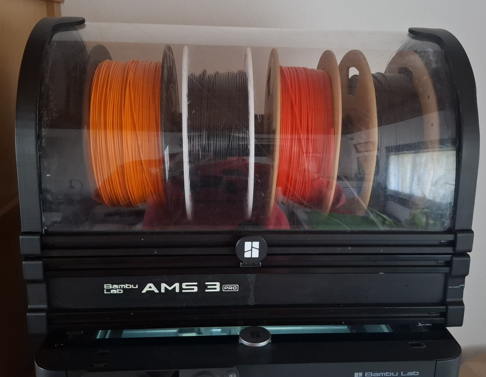
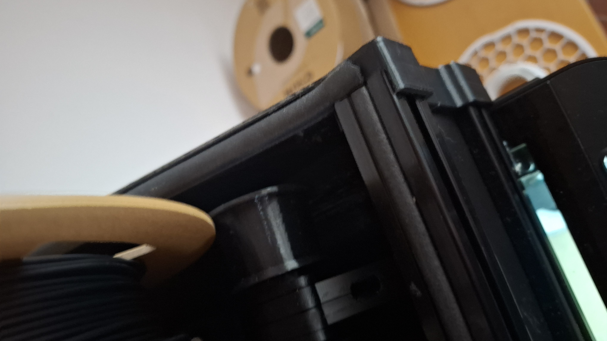
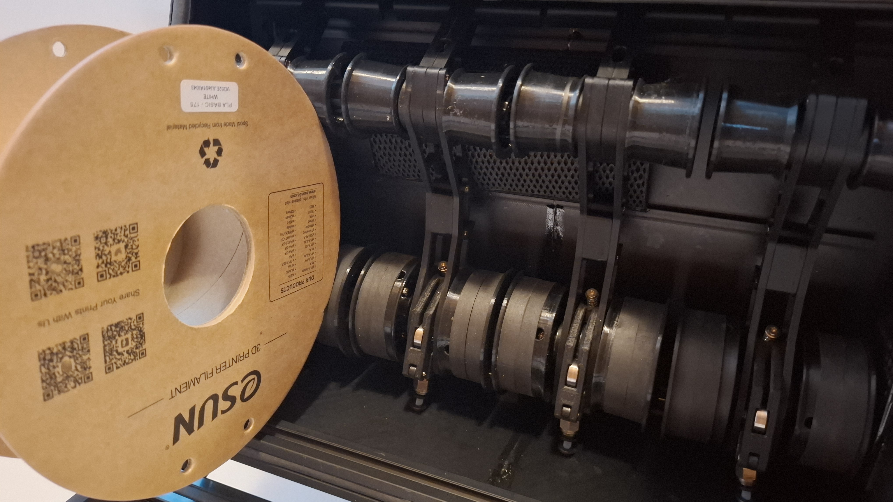
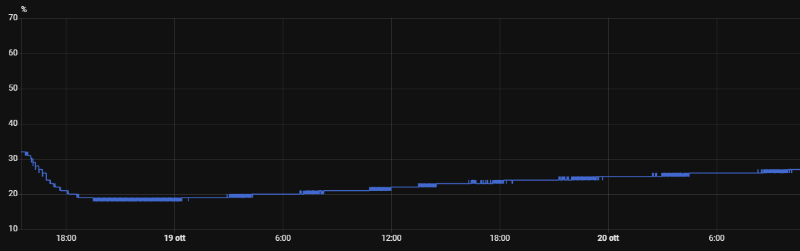
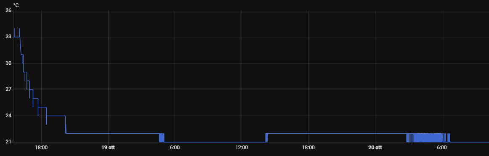
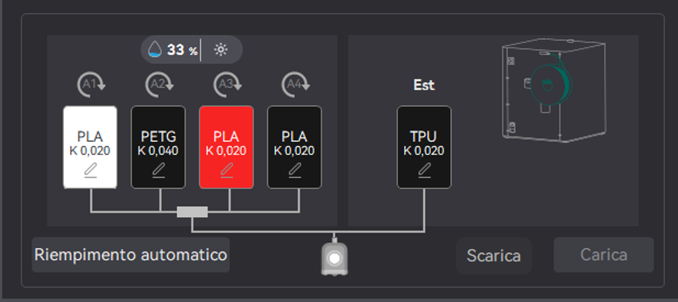
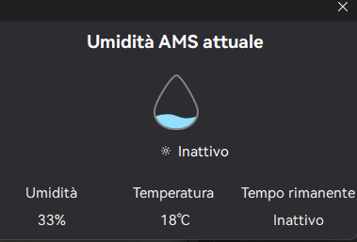
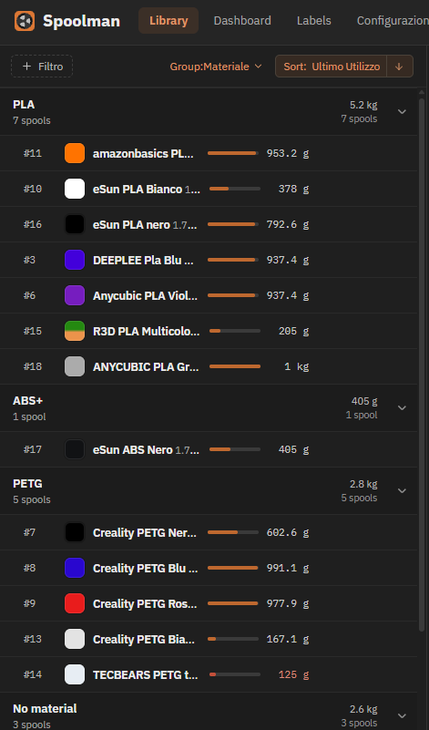

# Active Multifilament System 3 Pro – 4-Spool Enclosed Multi-Filament System

A heated, dryable, auto-rewinding 4-spool filament system designed for Bambu Lab printers and driven by a **BMCU-C Hall** unit.

## Features

- Automatic filament rewinding on filament change
- Active drying via heatsink and fan (from an EIBOS Cyclopes dryer)
- Passive drying via silica gel
- Compatible with the **BMCU-C Hall** version
- Built-in temperature and humidity sensor (AHT20), readable from the slicer
- Multicolor printing with up to **4 spools**

## Credits

Inspired by the **Filamentalist Enclosure** – many thanks to its developer.

Main changes from the original project to make it suit the Bambu Lab ecosystem:

- Scaled down to 4 spools
- Uses the [Filamentalist FV3 rewinder](https://github.com/Carrot-collective/ERCF_v2/tree/master/Recommended_Options/Filamentalist_Rewinder/Filamentalist_FV3_Rewinder), with improvements
- Structure fully 3D-printed in ABS, except for the polycarbonate lid panel

> [!WARNING]
> The system has **not been tested** with flexible filaments or TPU.

---

1. [Bill of Materials](#bill-of-materials)
2. [Tools](#tools)
3. [Printing the Parts](#printing-the-parts)
4. [Assembly Guide](#assembly-guide)
5. [Sensor Wiring and Firmware](#sensor-wiring-and-firmware)
6. [Spoolman (Spool Weight Tracking)](#spoolman-spool-weight-tracking)
7. [Test Results](#test-results)

---

## Bill of Materials

Items marked **(optional)** can be skipped.

### Structure

| Qty | Part | Notes |
|----:|------|-------|
| 6 | 2020 aluminium extrusion, V-slot, 400 mm | Frame |
| 1 | Polycarbonate panel, 1.5 or 2 mm, **449 × 398 mm** | Lid – cut to size yourself |
| 12 | [M6 screws](https://www.aliexpress.com/item/1005005070119421.html), ≥ 10 mm | Frame assembly |
| 4 | [M5×10 flat-head screws](https://www.aliexpress.com/item/1005005070119421.html) | Hinge mounting |
| 2 | M5 screws (cut to length) | Hinge pins – the lid rotates around them |

### Electronics

| Qty | Part | Notes |
|----:|------|-------|
| 1 | BMCU-C Hall sensor unit | Controller |
| 1 | [AHT20 sensor](https://www.aliexpress.com/item/1005012122393335.html) | Temperature and humidity |
| 2 | [M2×8 mm self-tapping screws](https://www.aliexpress.com/item/1005004247514440.html) | Sensor mounting |
| 1 | [EIBOS Cyclopes filament dryer](https://shop.eibos3d.com/products/filament-dryer) | Donor for heater, fan and display |
| 1 | [COB LED strip, 220 V](https://www.aliexpress.com/item/1005008141903647.html) | **(optional)** Interior lighting |

### Filament path and sealing

| Qty | Part | Notes |
|----:|------|-------|
| 4 | Filamentalist FV3 units | Filament exit pointing **outwards** |
| 5 m | PTFE tube | |
| 4 | PTFE tube fittings (inserts) | |
| 5 m | [D-profile gasket, 9×6 mm](https://www.aliexpress.com/item/1005006582760433.html) | |
| 1 | Silicone sealant, clear or black | |
| 1 | Two-part epoxy glue | For joining printed parts |
| 200 g | Silica gel | Passive drying |
| 1 | White acrylic | Only if you don't already have an AMS – used for the labels |

## Tools

- Hacksaw
- M6 tap (for threading the extrusions)
- Soldering iron
- Bed adhesion glue **(optional)**

---

## Printing the Parts

The parts are too large for a 256 × 256 mm print bed, so they are **split into pieces that you glue together after printing**.

- **Material:** ABS or ABS+ (tested), or ASA.
- **Everything inside the enclosure must be heat-resistant**, including all the Filamentalist 3 parts.

---

## Assembly Guide

### Step 1 – Prepare the frame

1. Print the parts and glue the split pieces together.
2. Thread **both ends** of all six 2020 extrusions with the M6 tap.
3. Cut the polycarbonate panel to **449 × 398 mm** with the hacksaw.

<!-- TODO: photo of threaded extrusions and printed parts -->

### Step 2 – Assemble the main structure

1. Insert the extrusions into the printed plastic structure.
2. Slide in the thin plastic walls.
3. Fit the other side of the structure.
4. Insert the 3D-printed bolts for the hinges at the back.
5. Close the base structure with **8 × M6 screws**.

<!-- TODO: photo of the assembled frame -->

### Step 3 – Fit the polycarbonate lid panel

> [!TIP]
> This step takes **two people**: the polycarbonate tries to spring back to its original shape.

1. One person holds the plastic bulkheads in place.
2. The other slides the panel into the rail of the structure until it reaches the extrusion you mounted earlier.
3. Insert the last extrusion and secure it with the final **4 × M6 screws**.

<!-- TODO: photo of the panel being inserted -->

### Step 4 – Dismantle the EIBOS Cyclopes dryer

1. Unscrew the screws on the feet and remove the bottom.
2. Unscrew the fan with its heatsink – these will be reused on the enclosure.
3. Remove the display (it is held by a snap fit).

<!-- TODO: photo of the dryer taken apart -->

### Step 5 – Mount the active drying unit

1. Mount the heatsink and fan on the enclosure using the same screws – **fit the fan screws the opposite way round**.
2. Snap the display into place.
3. Insert the dryer's temperature probe into the **upper extrusion**.

<!-- TODO: photo of the mounted dryer module -->

### Step 6 – Power cable and LED strip

Before permanently closing the active-drying side:

1. Pass the dryer's power cable through the dedicated hole at the back.
2. *(Optional)* Solder the LED strip **in parallel** onto the same cable for interior lighting.

### Step 7 – Close the electronics bay and install the sensor

1. Glue in the bulkhead that hides the electronics and exposed cables.
2. Mount the **AHT20** sensor with **2 × M2×8 mm** screws (the same ones used for the BMCU module).
3. To pass the cable connector through the slot, cut it off, feed the cable through, then **solder it back**.
4. Wire it to the BMCU as described in [Sensor Wiring and Firmware](#sensor-wiring-and-firmware).

<!-- TODO: photo of the sensor mounted -->

### Step 8 – Silica gel container

1. Print the silica gel container.
2. Fill it with silica gel.
3. Snap it onto the rail at the bottom of the enclosure – **check the orientation**.

### Step 9 – Seal the enclosure

1. Press the gasket into **all** slots of the module.
2. Apply silicone on the curved walls.
3. Also apply silicone around the humidity sensor slot.

<!-- TODO: photo of gaskets and silicone -->

### Step 10 – Install the Filamentalist rewinders

1. Assemble the Filamentalist modules and **check their tension**.
2. Fit the mounting arm for each module.
3. Insert all **4 rewinders** and align each with its PTFE hole.
4. Fit the PTFE fitting and the PTFE tube.

<!-- TODO: photo of the rewinders installed -->

### Step 11 – Test

1. Connect the module to the BMCU.
2. Check that all four spools **load and unload** correctly.

### Step 12 – Mount the lid

1. Fit the lid with its hinges and the **4 × M5×10** screws.
2. Use the **2 × cut M5 screws** as the pivot pins the lid rotates around.
3. Tighten the M5×10 screws into the bolts previously inserted in the extrusions.

<!-- TODO: photo of the finished build with the lid closed -->

---

## Sensor Wiring and Firmware

Connect the AHT20 to the BMCU as follows:

| AHT20 | BMCU |
|-------|------|
| V+ | 3.3 V |
| GND | GND |
| SDA | E_TX |
| SCL | E_RX |

**Firmware:** you must flash a firmware that supports the sensor – [BMCU-C-PJARCZAK v4.0.0-tpu](https://github.com/DZRAB/BMCU-C-PJARCZAK/releases/tag/v4.0.0-tpu).

> [!NOTE]
> If the sensor is wired correctly, the BMCU LED **flashes white rapidly** at power-on. If it doesn't, you have most likely swapped **SDA and SCL**.

Once working, temperature and humidity are visible from the slicer.

### Spool order in the slicer (reversed firmware)

It is more convenient to connect the BMCU spool channels **in reverse order**. To keep the slicer display natural, I made a custom BMCU firmware that **mirrors the slot order**, so the spools appear **from left to right in ascending order (1 → 4)** in the slicer.

- Flash the custom firmware from the [`BMCU_firmware`](BMCU_firmware/) folder.
- With this firmware, connect the spool channels in reverse order, as described in the assembly guide.

> [!NOTE]
> If you use the standard firmware instead, the slicer will show the spools in reverse order compared to their physical position.

---

## Test Results

**Test conditions**

- A 3-hour drying cycle at **65 °C** with the vents open
- Vents then closed with TPU plugs
- Test run **without silica gel**

**Humidity** – relative humidity rises by about **0.65 % per hour**. This can improve depending on how well drafts are kept out of the enclosure.

**Temperature (°C)**

**view from the slicer**

spoolman.png

---

## Spoolman (Spool Weight Tracking)

To get an up-to-date estimate of the remaining weight of each spool, I set up a **Spoolman** server.

1. **Set up the server** by following the [Spoolman guide](https://github.com/Donkie/Spoolman).
2. **Use Orca Slicer** (at least **v2.5.0-Alpha**). The Bambu Lab slicer does not support plugins, so it can't be used for this.
3. **Install the [Orca Slicer plugin](https://cloud.orcaslicer.com/p/335694591ea6)** that updates the filament used during slicing.
   - If it doesn't work, replace the plugin's Python file in `C:\Users\<User>\AppData\Roaming\OrcaSlicer\orca_plugins` with the fixed version provided here. [`Spoolman Plugin`](Spoolman_plugin/)
4. In Orca Slicer, open the **Plugin** screen and enable Spoolman with the script **"Spoolman Settings e guide"**, then follow the on-screen guide.

---
<!-- TODO: add a License section -->
